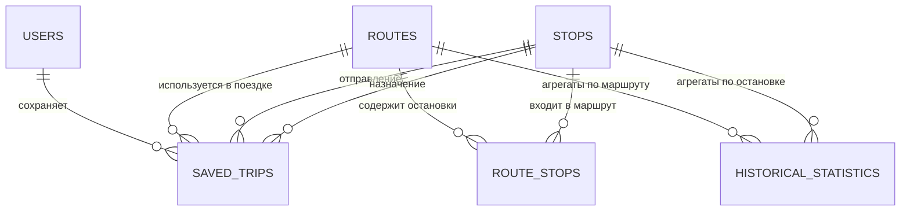

# Слой данных: PostgreSQL, Flyway и JPA

Документ описывает схему БД сервиса оценки надёжности общественного транспорта
Санкт-Петербурга, индексы, репозитории и правила работы с миграциями.

## 1. Стек и принципы

| Компонент | Версия / решение |
|---|---|
| СУБД | PostgreSQL 16 |
| Миграции | Flyway, SQL-файлы в `backend/src/main/resources/db/migration` |
| ORM | Spring Data JPA / Hibernate 6 |
| Пул соединений | HikariCP |
| Часовой пояс | `Europe/Moscow` (TIMESTAMPTZ в БД, `hibernate.jdbc.time_zone`) |
| Схема | Только Flyway (`spring.jpa.hibernate.ddl-auto=validate`) |

Ключевые ограничения:

- схему создаёт и изменяет **только Flyway**, Hibernate лишь проверяет соответствие
  сущностей таблицам при старте;
- `spring.flyway.clean-disabled=true` — случайная очистка БД невозможна;
- идентификаторы — `BIGSERIAL` (автоинкремент PostgreSQL);
- дата/время — `TIMESTAMPTZ`, локальное время прибытия — `TIME` без зоны;
- координаты — `NUMERIC(9, 6)` с проверкой допустимого диапазона;
- сырые данные агрегатора лежат в `transport_updates.payload` типа `JSONB`.

## 2. ER-диаграмма



`transport_updates` намеренно не имеет внешних ключей: это staging-таблица сырых
событий внешнего агрегатора. Маршрут, остановка, рейс и транспортное средство
хранятся строковыми `*_external_id` и могут появиться в БД позже самого события.

## 3. Словарь данных

### 3.1. `users`

| Колонка | Тип | Ограничения | Назначение |
|---|---|---|---|
| `id` | `BIGSERIAL` | PK | Идентификатор |
| `email` | `VARCHAR(255)` | NOT NULL, CHECK не пустой | Email; уникальность без учёта регистра |
| `password_hash` | `VARCHAR(255)` | NULL | Хеш пароля (NULL — вход без локального пароля) |
| `display_name` | `VARCHAR(100)` | NULL | Отображаемое имя |
| `created_at` | `TIMESTAMPTZ` | NOT NULL, DEFAULT `now()` | Создание записи |
| `updated_at` | `TIMESTAMPTZ` | NOT NULL, DEFAULT `now()` | Последнее изменение |

Уникальность email обеспечивает функциональный индекс `ux_users_email_lower`
по `lower(email)`, поэтому `Test@Example.com` и `test@example.com` считаются
одним адресом.

### 3.2. `routes`

| Колонка | Тип | Ограничения | Назначение |
|---|---|---|---|
| `id` | `BIGSERIAL` | PK | Идентификатор |
| `external_id` | `VARCHAR(100)` | NOT NULL, UNIQUE | ID маршрута во внешнем источнике |
| `name` | `VARCHAR(255)` | NOT NULL, CHECK не пустой | Название («Трамвай 7») |
| `type` | `VARCHAR(50)` | NOT NULL, CHECK | `BUS`, `TRAM`, `TROLLEYBUS`, `METRO`, `SUBURBAN_RAIL`, `OTHER` |
| `created_at` | `TIMESTAMPTZ` | NOT NULL | Создание записи |
| `updated_at` | `TIMESTAMPTZ` | NOT NULL | Последнее изменение |

### 3.3. `stops`

| Колонка | Тип | Ограничения | Назначение |
|---|---|---|---|
| `id` | `BIGSERIAL` | PK | Идентификатор |
| `external_id` | `VARCHAR(100)` | NOT NULL, UNIQUE | ID остановки во внешнем источнике |
| `name` | `VARCHAR(255)` | NOT NULL, CHECK не пустой | Название остановки |
| `latitude` | `NUMERIC(9, 6)` | NOT NULL, CHECK −90…90 | Широта |
| `longitude` | `NUMERIC(9, 6)` | NOT NULL, CHECK −180…180 | Долгота |
| `created_at` | `TIMESTAMPTZ` | NOT NULL | Создание записи |
| `updated_at` | `TIMESTAMPTZ` | NOT NULL | Последнее изменение |

Поиск по названию использует `ILIKE '%…%'`, который поддерживается
GIN-индексом `ix_stops_name_trgm` (расширение `pg_trgm`).

### 3.4. `route_stops`

Упорядоченные остановки маршрута по направлениям.

| Колонка | Тип | Ограничения | Назначение |
|---|---|---|---|
| `route_id` | `BIGINT` | PK, FK → `routes` ON DELETE CASCADE | Маршрут |
| `direction_id` | `SMALLINT` | PK, DEFAULT 0, CHECK ≥ 0 | Направление (как в GTFS) |
| `sequence_number` | `INTEGER` | PK, CHECK ≥ 0 | Порядок остановки |
| `stop_id` | `BIGINT` | NOT NULL, FK → `stops` ON DELETE RESTRICT | Остановка |

Составной первичный ключ `(route_id, direction_id, sequence_number)` не даёт
дублировать позицию в направлении. Удаление маршрута удаляет его остановки;
удалить остановку, пока она используется, нельзя.

### 3.5. `saved_trips`

| Колонка | Тип | Ограничения | Назначение |
|---|---|---|---|
| `id` | `BIGSERIAL` | PK | Идентификатор |
| `user_id` | `BIGINT` | NOT NULL, FK → `users` ON DELETE CASCADE | Владелец |
| `route_id` | `BIGINT` | NOT NULL, FK → `routes` ON DELETE RESTRICT | Маршрут |
| `direction_id` | `SMALLINT` | NOT NULL, DEFAULT 0, CHECK ≥ 0 | Направление |
| `from_stop_id` | `BIGINT` | NOT NULL, FK → `stops` ON DELETE RESTRICT | Остановка отправления |
| `to_stop_id` | `BIGINT` | NOT NULL, FK → `stops` ON DELETE RESTRICT | Остановка назначения |
| `name` | `VARCHAR(255)` | NOT NULL, CHECK не пустой | Название поездки |
| `arrival_time` | `TIME` | NOT NULL | Желаемое время прибытия (Europe/Moscow) |
| `created_at` | `TIMESTAMPTZ` | NOT NULL | Создание записи |
| `updated_at` | `TIMESTAMPTZ` | NOT NULL | Последнее изменение |

Проверка `ck_saved_trips_different_stops` запрещает поездку с совпадающими
остановками отправления и назначения.

### 3.6. `historical_statistics`

Суточные агрегаты надёжности по паре «маршрут + остановка».

| Колонка | Тип | Ограничения | Назначение |
|---|---|---|---|
| `id` | `BIGSERIAL` | PK | Идентификатор |
| `route_id` | `BIGINT` | NOT NULL, FK → `routes` ON DELETE RESTRICT | Маршрут |
| `stop_id` | `BIGINT` | NOT NULL, FK → `stops` ON DELETE RESTRICT | Остановка |
| `stat_date` | `DATE` | NOT NULL | Дата агрегации |
| `trips_count` | `INTEGER` | NOT NULL, DEFAULT 0, CHECK ≥ 0 | Всего рейсов |
| `delayed_trips` | `INTEGER` | NOT NULL, CHECK 0…`trips_count` | С опозданием |
| `cancelled_trips` | `INTEGER` | NOT NULL, CHECK 0…`trips_count` | Отменённые |
| `average_delay` | `NUMERIC(8, 2)` | NULL | Средняя задержка, мин |
| `median_delay` | `NUMERIC(8, 2)` | NULL | Медианная задержка, мин |
| `max_delay` | `NUMERIC(8, 2)` | NULL | Максимальная задержка, мин |
| `computed_at` | `TIMESTAMPTZ` | NOT NULL, DEFAULT `now()` | Время расчёта |

Уникальный индекс `ux_historical_statistics_route_stop_date` делает пересчёт
идемпотентным: на одну пару и дату хранится ровно одна запись.
`delayed_trips + cancelled_trips <= trips_count` проверяется ограничением
`ck_historical_status_sum`.

### 3.7. `transport_updates` (staging)

Сырые наблюдения внешнего агрегатора (задача №1). Таблица предназначена для
повторной обработки и диагностики, поэтому хранится ограниченное время.

| Колонка | Тип | Ограничения | Назначение |
|---|---|---|---|
| `id` | `BIGSERIAL` | PK | Идентификатор |
| `source` | `VARCHAR(50)` | NOT NULL | Источник (`gtfs-realtime`, …) |
| `route_external_id` | `VARCHAR(100)` | NULL | ID маршрута во внешнем API |
| `stop_external_id` | `VARCHAR(100)` | NULL | ID остановки |
| `trip_external_id` | `VARCHAR(100)` | NULL | ID рейса |
| `vehicle_external_id` | `VARCHAR(100)` | NULL | ID транспортного средства |
| `event_type` | `VARCHAR(30)` | NOT NULL, CHECK | `VEHICLE_POSITION`, `TRIP_UPDATE`, `ALERT` |
| `observed_at` | `TIMESTAMPTZ` | NOT NULL | Время события по данным источника |
| `scheduled_at` | `TIMESTAMPTZ` | NULL | Плановое время |
| `actual_at` | `TIMESTAMPTZ` | NULL | Фактическое время |
| `delay_seconds` | `INTEGER` | CHECK −86400…86400 | Задержка, сек |
| `status` | `VARCHAR(20)` | NOT NULL, DEFAULT `UNKNOWN` | `ON_TIME`, `DELAYED`, `CANCELLED`, `UNKNOWN` |
| `payload` | `JSONB` | NOT NULL | Исходный JSON для повторной обработки |
| `received_at` | `TIMESTAMPTZ` | NOT NULL, DEFAULT `now()` | Время получения |

Очистка старых наблюдений выполняется методом
`TransportUpdateRepository.deleteOlderThan(Instant cutoff)`; рекомендуется
запускать её по расписанию и хранить события 7–30 дней.

## 4. Индексы

| Индекс | Таблица | Назначение |
|---|---|---|
| `ux_users_email_lower` | `users` | Регистронезависимая уникальность email |
| `ux_routes_external_id` | `routes` | Идемпотентный upsert маршрутов |
| `ux_stops_external_id` | `stops` | Идемпотентный upsert остановок |
| `ix_stops_name_trgm` | `stops` | Поиск по названию (`ILIKE '%…%'`) |
| `ix_saved_trips_user_created` | `saved_trips` | Список поездок пользователя по дате |
| `ix_saved_trips_route` | `saved_trips` | Поиск поездок по маршруту |
| `ix_saved_trips_from_stop` | `saved_trips` | Поиск по остановке отправления |
| `ix_saved_trips_to_stop` | `saved_trips` | Поиск по остановке назначения |
| `ix_route_stops_stop` | `route_stops` | Маршруты через остановку |
| `ux_historical_statistics_route_stop_date` | `historical_statistics` | Идемпотентный пересчёт |
| `ix_historical_statistics_route_date` | `historical_statistics` | Статистика маршрута за период |
| `ix_historical_statistics_stop_date` | `historical_statistics` | Статистика остановки за период |
| `ix_historical_statistics_stat_date_brin` | `historical_statistics` | Диапазоны дат на больших объёмах |
| `ix_transport_updates_route_observed` | `transport_updates` | События маршрута за период |
| `ix_transport_updates_stop_observed` | `transport_updates` | События остановки за период |
| `ix_transport_updates_observed_brin` | `transport_updates` | Очистка и диапазоны по времени |

BRIN выбран для `stat_date` и `observed_at`, потому что данные в этих колонках
естественно упорядочены по времени и занимают мало места по сравнению с B-tree.

## 5. Репозитории

| Репозиторий | Основные методы |
|---|---|
| `UserRepository` | `findByEmailIgnoreCase`, `existsByEmailIgnoreCase` |
| `RouteRepository` | `findByExternalId`, `existsByExternalId`, `findByTypeOrderByNameAsc` |
| `StopRepository` | `findByExternalId`, `existsByExternalId`, `searchByName` |
| `RouteStopRepository` | `findRouteStops(routeId, directionId)`, `findRoutesByStopId(stopId)` |
| `SavedTripRepository` | `findByUserIdOrderByCreatedAtDesc`, `findByIdAndUserId`, `existsByIdAndUserId` |
| `HistoricalStatisticRepository` | `findByRouteIdAndStopIdAndStatDate`, выборки за период |
| `TransportUpdateRepository` | `findByRouteExternalIdAndObservedAtAfter…`, `deleteOlderThan` |

Списки поездок и статистика за период загружают связанные сущности через
`@EntityGraph`/`join fetch`, чтобы избежать N+1 при `open-in-view=false`.

## 6. Политика миграций

1. Каждое изменение схемы — новый файл `V<номер>__<краткое_описание>.sql` в
   `backend/src/main/resources/db/migration`.
2. Уже применённые миграции **не редактируются**: Flyway проверяет контрольные
   суммы. Исправления оформляются следующей версией.
3. Имена проверяются `validate-migration-naming=true`.
4. Для несовместимых изменений используется схема expand → migrate → contract:
   сначала добавить новую колонку/таблицу, затем перенести данные и код, и
   только потом удалить старое.
5. `ddl-auto=validate` не позволяет приложению молча создать или изменить схему.
6. Тесты применяют те же миграции на чистом встроенном PostgreSQL, поэтому
   расхождение между SQL и JPA-сущностями обнаруживается в CI.

## 7. Запуск

### 7.1. PostgreSQL через Docker Compose

```bash
cp .env.example .env          # Windows PowerShell: Copy-Item .env.example .env
docker compose up -d postgres
docker compose ps             # дождитесь статуса healthy
```

### 7.2. Просмотр БД через pgAdmin

pgAdmin включён в compose как необязательный сервис (профиль `tools`):

```bash
docker compose --profile tools up -d
```

Веб-интерфейс: <http://localhost:5050>. Логин и пароль по умолчанию —
`admin@example.com` / `spb_admin` (меняются через `PGADMIN_DEFAULT_EMAIL`,
`PGADMIN_DEFAULT_PASSWORD` и `PGADMIN_PORT` в `.env`).

При добавлении сервера в pgAdmin (внутри Docker):

| Поле | Значение |
|---|---|
| Name | `SPb Transit` |
| Host | `postgres` |
| Port | `5432` |
| Maintenance database | `spb_transit` |
| Username | `spb_app` |
| Password | `spb_app` |

Если используется pgAdmin Desktop, укажите `localhost` и порт из
`POSTGRES_PORT` (по умолчанию `5432`). Учётные данные должны совпадать с
`POSTGRES_*` в `.env`.

### 7.3. Приложение

```bash
cd backend
./mvnw spring-boot:run        # Windows: .\mvnw.cmd spring-boot:run
```

При старте Flyway применит миграции, Hibernate проверит схему. Параметры
подключения берутся из переменных окружения `DB_URL`, `DB_USER`,
`DB_PASSWORD` (см. `backend/src/main/resources/application.yml`).

### 7.4. Тесты

```bash
cd backend
./mvnw test                   # Windows: .\mvnw.cmd test
```

Интеграционные тесты поднимают встроенный PostgreSQL 16.15 через
`io.zonky.test:embedded-postgres`, поэтому Docker для тестов не требуется.
H2 не используется: схема опирается на `JSONB`, `pg_trgm` и BRIN-индексы.

### 7.5. Проверка схемы вручную

```bash
docker compose exec postgres psql -U spb_app -d spb_transit
\dt
\d+ transport_updates
select version, description, success from flyway_schema_history order by installed_rank;
```

## 8. Связанные документы

- [REST API](api.md) — методы, аутентификация, форматы ответов и правила
  расчёта статуса и надёжности.
- [README](../README.md) — быстрый старт и переменные окружения.
